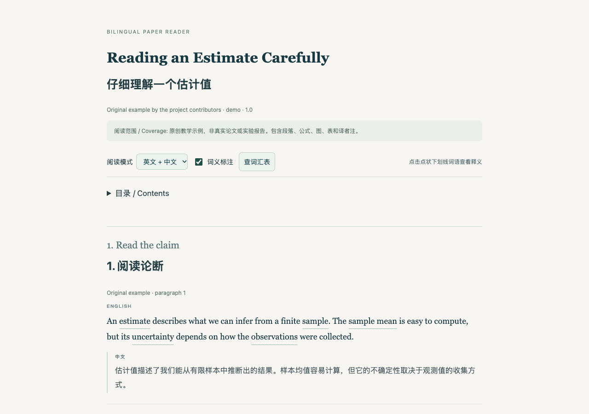

# Bilingual Paper Reader · 双语论文精读

把英文论文做成一个可以离线打开的精读网页：**英文原文 → 中文翻译 → 语境词义**。

这是一份可复用的 Codex skill，附带零运行时依赖的 Python 网页生成器。它把阅读方式、翻译要求和检查流程一起保存下来。生成器负责排版和交互，翻译由使用技能的 AI 助手完成并核对。

## 阅读体验

- 按论文顺序逐句翻译。默认每段英文后紧接中文，也可按句分块。
- 难词和词组显示点状下划线，点击查看中文释义和当前语境说明。
- 支持可搜索词汇表、关闭标注，以及双语、仅英文、仅中文三种模式。
- 保留数学公式、真实图表、编号、引用和附录。译者解释单独标记。
- 单栏响应式布局。生成的 HTML 包含全部样式、交互和图片，可离线阅读。



示例是原创教学内容，不是真实论文或实验。下载 [demo.html](examples/demo.html) 后用浏览器打开即可体验；GitHub 的文件预览不会执行网页交互。

## 安装 skill

克隆到 Codex 的个人技能目录，或你的环境配置的技能目录：

```sh
git clone https://github.com/mkj69/bilingual-paper-reader.git "${CODEX_HOME:-$HOME/.codex}/skills/bilingual-paper-reader"
```

已有同名目录时先检查内容，不要覆盖。让 Codex 重新加载技能后，可直接说：

> 使用 $bilingual-paper-reader，把这篇论文做成双语精读网页。每段先显示英文原文，再显示完整中文翻译，给难词和专业词组添加语境释义。保留公式、图表和附录。

也可以要求更细的显示粒度：

> 使用 $bilingual-paper-reader，按一句英文、一句中文排版。多标注学术写作词汇，解释单词在这一句中的意思。

提供本地 PDF、论文链接或明确的 arXiv 编号和版本。是否能完整转换取决于材料可访问性和适用的内容使用规则。技能要求如实记录缺失内容，不把摘要或节选说成全文。

## 运行网页生成器

需要 Python 3.10+，无需安装 Python 第三方库。以下命令从仓库根目录运行：

```sh
python3 scripts/build_reader.py examples/demo.json reader.html
```

用浏览器打开 `reader.html`。自己的论文内容按照 [输入格式](references/input-format.md) 整理成 JSON。数学使用原生 MathML，图片使用本地 PNG、JPEG、GIF 或 WebP。脚本不会自动下载或翻译论文。

```sh
python3 -m unittest discover -s tests -v
```

可选浏览器检查使用 Playwright：

```sh
npm install --no-save playwright
npx playwright install chromium
node tests/browser_check.cjs examples/demo.html
```

已有系统浏览器时可设置 `BROWSER_PATH`，无需下载浏览器。浏览器检查覆盖桌面和手机宽度、词义弹窗、词汇搜索、阅读模式、图片及离线加载。

## 仓库结构

| 路径 | 内容 |
| --- | --- |
| `SKILL.md` | 技能触发条件与完整工作流程 |
| `agents/openai.yaml` | Codex 技能名称与默认提示语 |
| `scripts/build_reader.py` | 离线网页生成器 |
| `assets/` | 阅读界面样式和交互 |
| `references/` | 输入规范和核对清单 |
| `examples/` | 原创双语示例与预览 |
| `tests/` | 生成器测试与可选浏览器检查 |

## 使用边界

本仓库公开的是阅读工具和原创示例。论文原文、完整译文、未发表材料、个人笔记及对话记录不会因使用技能而自动发布。需要分享生成的阅读页时，应单独确认发布范围及材料的适用使用条件。

目前默认界面和释义语言为中文，原文为英文。复杂的合并单元格、交叉格式词组和特殊数学结构可能需要调整输入或扩展生成器。自动化检查验证结构与交互，不能代替逐句翻译核对。

## English

An English-first Chinese bilingual paper-reading skill for Codex. It preserves source order, pairs faithful translations with the original text, and adds contextual vocabulary explanations. The included Python renderer creates a single offline HTML file with glossary search, language modes, native MathML, embedded figures and tables. It requires Python 3.10 or newer and no runtime packages. The demo is original material. Source acquisition and translation remain the assistant's responsibility.

## License

MIT for this skill, its code and original examples. This license does not cover third-party papers used with the tool.
